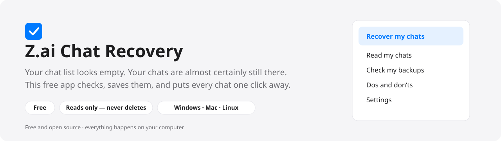
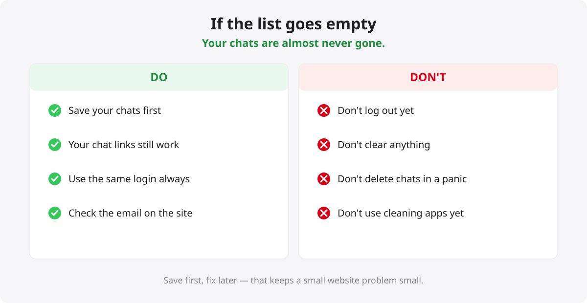
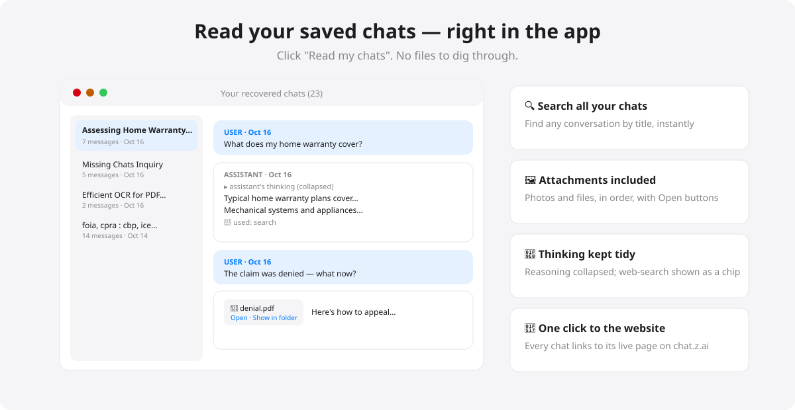
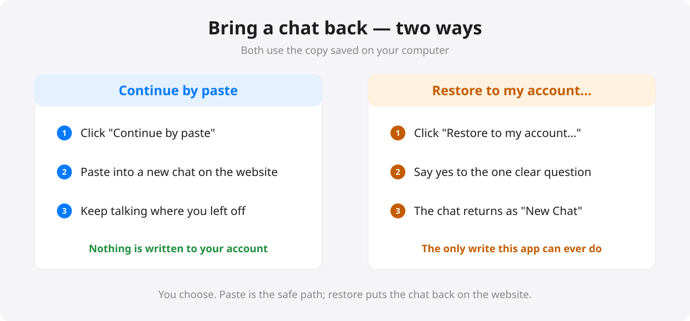

# Z.ai Chat Recovery



**Your chat list looks empty. Take a breath — your chats are almost certainly still there.**

Sometimes the chat.z.ai website stops showing your conversation list (it happened to many people on October 16, 2026). It looks like everything was deleted. It almost never is. The chats are still on the website's computers — only the list stopped showing.

This free, open-source app checks that for you, saves every conversation to your computer, lets you read them comfortably, and can even put a chat back into your account if you want it there again.

[](LICENSE)

## What do I do?

1. **Download** the app for your computer from [Releases](../../releases) (see the table below).
2. **Open it and click "Check my chats."** It looks for your saved sign-in (Chrome, Edge, Brave, or Firefox) and tells you in plain words what it finds — like *"Good news — we can see your 23 chats."*
3. **Click "Save all my chats."** Everything is copied to a folder on your computer: readable pages, the direct links to each chat, and a safe full-fidelity copy.

That's it. Three steps, two buttons.

> **One thing first:** make sure you've logged in to [chat.z.ai](https://chat.z.ai) with your Google account in your browser at least once on this computer. Your chats live in that account — the app uses that saved sign-in to reach them. (The app reminds you of this on its main screen.)

## Downloads

| File | For |
|---|---|
| `ZaiChatRecovery-windows-x64.zip` | Windows 10/11 — unzip, open the folder, run `ZaiChatRecovery.exe` |
| `ZaiChatRecovery-mac-arm64.zip` | Mac with Apple chip (M1/M2/M3…) — the first time: right-click the app → **Open** |
| `ZaiChatRecovery-mac-x64.zip` | Intel Mac — same right-click → Open the first time |
| `ZaiChatRecovery-linux-x64.tar.gz` | Linux |
| `recover_zai_chats.py` | For people who like terminals: one Python file, no installs |

**Windows note:** Windows may show a blue "protected your PC" screen because the app isn't from a big company. Click **More info → Run anyway**. (The app is open source — anyone can read exactly what it does.)

## If you're worried right now



The short version: **save first, don't fix later.** Don't log out, don't clear anything, don't delete chats in a panic — those steps are how a display problem turns into a real loss. The chat links (`chat.z.ai/c/…`) still open even while the list is empty; save them first.

## Reading your saved chats



Click **"Read my chats"** and the app shows every conversation in a clean list — search, click, and read, with the assistant's reasoning kept out of the way, web searches noted, and any photos or files shown right where they appeared. Every chat also has an **"Open on chat.z.ai"** button and works with backups you saved earlier, including ones made by the Python tool.

## Bringing a chat back



Two buttons, your choice:

- **Continue by paste** — copies the whole conversation so you can paste it into a new chat and keep going. Nothing is written to your account.
- **Restore to my account…** — recreates the conversation as a new chat in your account (it appears as "New Chat"; rename it after opening). This is the **only** thing this app can ever write to your account, it happens only after you say yes to a clear explanation, and it never deletes or changes anything else.

## Common questions

| What you see | What to do |
|---|---|
| "No working sign-in" | Open chat.z.ai in your browser, log in (not as guest), come back — the app re-checks by itself. |
| The list shows someone else's (empty) account | Check the email at the top of the chat.z.ai website — Google and email sign-ins can be different accounts. |
| Mac says the app is from an "unidentified developer" | Right-click the app → **Open** → Open. Normal for apps not sold through the Mac App Store. |
| Where did my chats go? | Almost always: nowhere. It's a website display problem. This app proves it in ten seconds. |

## Your privacy, in one sentence

Everything happens on your computer; the app only ever talks to chat.z.ai, only ever reads (except the one restore button you explicitly approve), and your sign-in never leaves your machine.

## For developers and tinkerers

The Python one-liner works everywhere with no installs:

```
python recover_zai_chats.py
```

How it all actually works — the session-token discovery, the API, the backup formats, the import endpoint, and every engineering gotcha we hit — is documented in **[TECHNICAL_NOTES.md](TECHNICAL_NOTES.md)**.

## License

Apache-2.0 — see [LICENSE](LICENSE). Free to use, share, and modify.
