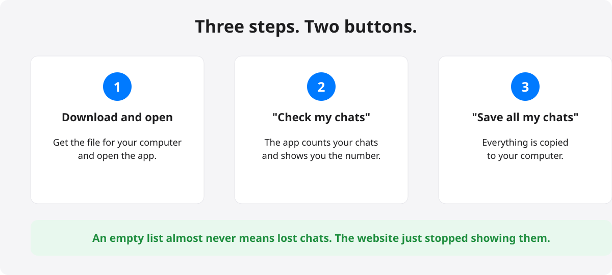
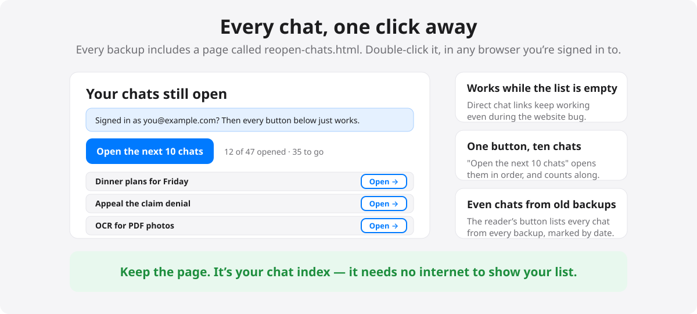

# Z.ai Chat Recovery


**Your chat list looks empty. Take a breath — your chats are almost certainly still there.**

Sometimes the chat.z.ai website stops showing your conversation list (it happened to many people on October 16, 2026). It looks like everything was deleted. It almost never is. The chats are still on the website's computers — only the list stopped showing.

This free, open-source app checks that for you, saves every conversation to your computer, and puts every chat one click away again.

[](LICENSE)

## What do I do?



1. **Download** the app for your computer from [Releases](../../releases) (see the table below).
2. **Press "Recover my chats."** The app looks for the sign-in your browser already saved (Chrome, Edge, Brave, or Firefox) and tells you in plain words what it finds — like *"Your 23 chats are safe."*
3. **Press "Save all my chats."** Everything is copied into a dated folder on your computer: readable pages, the direct links to each chat, and a safe full-fidelity copy.

That's it. One big button at a time.

Everything lives behind five plain-word tabs on the left:

| Tab | What it does |
|---|---|
| **Recover my chats** | Check, then save — one button at a time |
| **Read my chats** | Every conversation, readable like a chat, with search |
| **Photos & files** | Shows saved photos and files; re-downloads missing ones |
| **Check my backups** | Proves every saved file is intact |
| **Dos and don'ts** | Calm advice if the list goes empty again |
| **Settings** | Bigger text, monthly backups, technical details |

> **One thing first:** make sure you've logged in to [chat.z.ai](https://chat.z.ai) in your browser at least once on this computer. Your chats live in that account — the app uses that saved sign-in to reach them.

## Downloads

| File | For |
|---|---|
| `ZaiChatRecovery-windows-x64.zip` | Windows 10/11 — unzip, open the folder, run `ZaiChatRecovery.exe` |
| `ZaiChatRecovery-mac-arm64.zip` | Mac with Apple chip (M1/M2/M3…) — see "Mac: how to open it the first time" below |
| `ZaiChatRecovery-mac-x64.zip` | Intel Mac — same one-time open step below |
| `ZaiChatRecovery-linux-x64.tar.gz` | Linux |
| `recover_zai_chats.py` | For people who like terminals: one Python file, no installs |

**Windows note:** Windows may show a blue "protected your PC" screen because the app isn't from a big company. Click **More info → Run anyway**. (The app is open source — anyone can read exactly what it does.)

## Mac: how to open it the first time

The Mac blocks apps it doesn't recognize, including this one — that's Gatekeeper doing its job. You only have to do this **once**; after that, the app opens like any other.

**Step 1 — unzip and try to open it once.** Unzip the download, and double-click `ZaiChatRecovery.app`. Your Mac will say it can't be opened ("from an unidentified developer"). That's expected — this step makes your Mac record the app so you can approve it next.

**Step 2 — open System Settings.** Click the Apple menu (top-left corner of the screen) → **System Settings** → **Privacy & Security**.

**Step 3 — scroll down and click "Open Anyway".** Near the bottom you'll see a message about "ZaiChatRecovery" being blocked, with an **Open Anyway** button. Click it, enter your password or use Touch ID if asked, and the app opens.

**If your Mac is older** (macOS Ventura or earlier): instead of Steps 2–3, just **right-click** (or Control-click) the app in Finder → **Open** → click **Open** in the window that appears.

**If "Open Anyway" doesn't appear:** make sure you did Step 1 first (the button only shows up after the Mac has blocked the app once), then close and reopen System Settings.

## If you're worried right now


The short version: **save first, don't fix later.** Don't log out, don't clear anything, don't delete chats in a panic — those steps are how a display problem turns into a real loss. The chat links (`chat.z.ai/c/…`) still open even while the list is empty; save them first.

## Every chat, one click away



Every backup includes a page called **`reopen-chats.html`** — double-click it any time. It lists every chat with an **Open** button, so each conversation is one click away **even while the website's chat list looks empty**. "Open the next 10 chats" opens them in order and counts along.

The same page lives behind the **"Open chats in browser"** button in the reader — that version lists every chat from **every** backup you've ever made, and marks chats that only exist in older backups. Terminal folks: `python recover_zai_chats.py --open 10` reopens the 10 newest right away.

## Reading your saved chats


Open the **"Read my chats"** tab and every conversation is there in a clean list. Search by name, click one, and read it like a chat — with any photos or files shown right where they appeared.

**To open a chat on the website, straight from this tab:** double-click it in the list (or use the "Open on chat.z.ai" button). It opens in your browser, on the chat itself — no extra steps.

## Photos & files

Photos and files inside your chats are saved with your backups — but their links on the z.ai website **expire**, so files in a backup can go missing over time.

The **"Photos & files"** tab shows, in plain words, how many photos and files each chat has saved and flags the missing ones. One button — **"Update missing from website"** — re-downloads everything that's missing, with progress shown chat by chat. It only ever writes into your **newest** backup (older ones stay untouched), and it refreshes that backup's integrity list afterwards so "Check my backups" stays green.

## Bringing a chat back

- **Continue by paste** — copies the whole conversation so you can paste it into a new chat on the website and keep going. Nothing is written to your account. This is the safe path.

(Putting a chat back on the website as a new conversation will return soon — we've removed that button for now while we make it clearer.)

## Never lose them again: dated backups

Every time you save, the app creates a **new backup folder with the date on it** — like `Z.ai Backups/2026-10-18 2030`. Older backups are never touched or changed, so you can always go back to any day.

- **"Remember for me — back up every month"** (in Settings) — one checkbox, and the app backs up your chats automatically on the first of each month. No reminders to set, nothing to remember.
- **Unchanged chats cost nothing.** If a chat is the same as last month, the two backups share it quietly under the hood — you still see complete, independent folders for every date.
- **"Check my backups"** — its own tab. It re-checks every file in every dated backup against its built-in integrity list and tells you in plain words: *"All 100 files across 2 backups verified — everything is intact."* It runs by itself the first time you look. If anything ever gets damaged or deleted, it names the file and the date it can be recovered from.
- **Go back in time.** In the reader, the **Backup date** picker shows every saved date. Pick an older one to see your chats exactly as they were that day — and everything works there too: reading, copying, even restoring a chat back to your account from any date.

## If the letters feel small

Settings → **Text size** makes the whole app bigger — Normal, Large, or Largest — and remembers your choice. Big, calm text is the point: this app is built for a bad day, not for a resume.

## Common questions

| What you see | What to do |
|---|---|
| "Sign in first" | Open chat.z.ai in your browser, log in (not as guest), come back — the app re-checks by itself. |
| "This account has no chats" | Check the email at the top of the chat.z.ai website — Google and email sign-ins can be different accounts. Log in with the one that had your chats, then press Try again. |
| Mac says the app can't be opened | Follow **"Mac: how to open it the first time"** above — you approve the app once in Privacy & Security, then it opens normally. |
| Where did my chats go? | Almost always: nowhere. It's a website display problem. This app proves it in ten seconds. |
| A chat tab asked me to sign in | The browser you opened the page in wasn't signed in to chat.z.ai. Sign in there as the same account, then press the chat's Open button again. |

## Your privacy, in one sentence

Everything happens on your computer; the app only ever talks to chat.z.ai, only ever reads (except the one restore button you explicitly approve), and your sign-in never leaves your machine.

## For developers and tinkerers

The Python one-liner works everywhere with no installs:

```
python recover_zai_chats.py            # find token, recover all chats
python recover_zai_chats.py --open 10  # also reopen the 10 newest in your browser
```

How it all actually works — the session-token discovery, the API, the backup formats, the restore endpoint, the reopen page's popup-gesture rules, and every engineering gotcha we hit — is documented in **[TECHNICAL_NOTES.md](TECHNICAL_NOTES.md)**.

## License

Apache-2.0 — see [LICENSE](LICENSE). Free to use, share, and modify.
