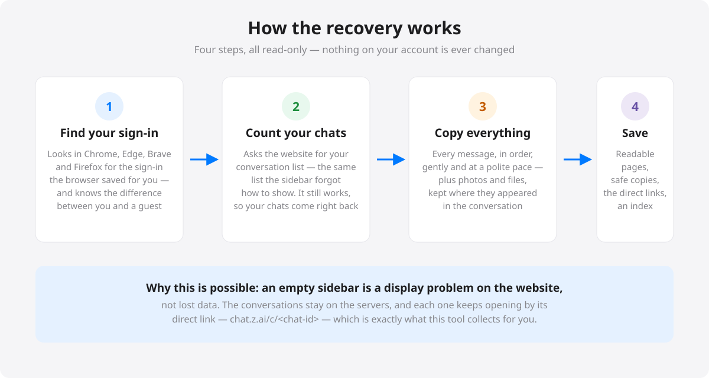

# Technical Notes — Z.ai Chat Recovery

How the tool actually works, for advanced users, contributors, and anyone
porting it. Written from the 2026-10-16 incident and the development that
followed; everything here was verified against live systems unless marked
otherwise.

## 1. Session discovery

- Chromium browsers keep site `localStorage` in LevelDB files:
  - Windows: `%LOCALAPPDATA%\<Browser>\User Data\<Profile>\Local Storage\leveldb`
  - macOS/Linux: browser root has no `User Data` layer; snap Chromium lives
    under `~/snap/chromium/common/chromium`
- Firefox keeps `localStorage` in `webappsstore.sqlite` (unencrypted) —
  scanned byte-wise, no SQLite driver needed.
- chat.z.ai stores its session JWT under the `token` key. The scanners read
  raw bytes of `*.log`/`*.ldb` (both ASCII and UTF-16LE passes) and regex for
  `eyJhbGciOi…` JWTs, decoding each payload's `email` claim.
- **Windows gotcha:** .NET `File.ReadAllBytes` opens with `FileShare.Read`,
  which fails on Chrome's live `.log` (Chrome holds a write handle). Open with
  `FileShare.ReadWrite | FileShare.Delete` or you silently scan nothing.
  Python's `open()` shares write access, which is why the CLI never hit this.
- Tokens carry no `exp` claim; the only validity test is calling the API.
  Candidates are ordered: real (non-guest) identities first, newest file and
  highest byte offset first — and validated in order until one returns 200.
- Guest trap: the web app silently falls back to a `guest-…@guest.com`
  session whose empty chat list looks exactly like total history loss.

## 2. API

All calls go to `https://chat.z.ai/api/v1` with `Authorization: Bearer <jwt>`:

| Call | Purpose |
|---|---|
| `GET /chats/?page=N&size=100` | full conversation list |
| `GET /chats/{id}` | per-chat detail (message **tree**, no content) |
| `POST /chats/{id}/messages/batch` `{"ids":[…]}` | message contents by id |
| `POST /chats/import` | restore a chat into the account (the only write) |
| attachment URLs (from content blocks) | downloaded with the same auth |

**The 307 quirk:** the CDN answers `GET /api/v1/chats` with
`307 → http://chat.z.ai/api/v1/chats/` — an HTTPS→HTTP downgrade plus a
trailing-slash canonicalization. Browser-grade clients survive; .NET refuses
the downgrade and strips `Authorization` on cross-origin redirects. The tool
follows redirects manually (≤6 hops), re-attaching the Bearer header and
forcing https; the canonical trailing-slash URL responds 200 directly.
The CDN (Alibaba ESA fronting an Open-WebUI-derived backend) also rate-limits
aggressive polling — pace requests and treat "no content" responses as
transient.

## 3. Data model

- `chat.history.messages` is an Open-WebUI-style **tree**: nodes with
  `parentId`/`childrenIds`; linearization walks root→leaf preferring the
  last child at each fork (the latest regeneration branch).
- Message content arrives as `content_blocks`; types observed in the wild:
  `text`, `reasoning` (the model's planning — must NOT render as body text),
  `tool_calls` (name + arguments + results; rendered as a compact chip), and
  attachment shapes (`image_url`, `file`, `audio`) with url/name variants.
- Backups on disk:
  - **Python-CLI schema**: full API detail with `content_detail` merged into
    each tree node (lossless, restore-ready).
  - **Enriched v2** (`schema: zai-recovery/2`): linear ordered messages with
    role/stamp/text/thinking/tools/attachments — built for the reader; the
    restore path synthesizes a tree from it when needed.
  - **Markdown twin**: human format; parsed back as a fallback for old
    app backups whose JSON predates content merging.

## 4. Attachments

Downloaded during recovery while the session is alive (links are private and
expire), stored under `attachments/<chat8>/NNN_name` with sequence numbers
preserving in-document order, referenced inline in the markdown and
structured in the v2 JSON. Failures are recorded as `missing: true` rather
than dropped. The repair path ("Fetch attachments") re-syncs one chat — and
**refuses to overwrite an existing backup if the API returns no content**,
because a rate-limited response must never destroy a good backup.

## 5. Restore (import) contract

Determined empirically (then cleaned up — test chats deleted):

- `POST /chats/import` with a **JSON body** (not multipart) containing a
  `chat` object with `history.messages` as the tree. The full detail object
  also works.
- Returns the new chat object with its server-assigned id.
- Title fields are ignored — restored chats appear as "New Chat".
- The app treats this as its only possible write, gated behind an explicit
  confirmation dialog; the CLI equivalent is `--restore <chat.json>`.

## 6. Desktop app (Avalonia, one codebase → Win/mac/Linux)

Avalonia gotchas paid for in bug reports, so you don't have to:

- **Loading no theme renders nothing.** `Styles.Add(new FluentTheme())`
  (plus a `RequestedThemeVariant`) is mandatory — without it, templated
  controls have zero size and the window looks blank.
- **Single-file publish breaks on macOS.** With ad-hoc codesigning,
  single-file bundles fail signature validation on embedded dylibs and are
  killed at launch. Ship the plain publish output inside the `.app` and
  `codesign --force --deep --sign -`. Gatekeeper still prompts (no Apple
  Developer ID); macOS Sequoia+ users approve via System Settings →
  Privacy & Security → "Open Anyway" (the old right-click → Open bypass was
  removed there), older macOS via right-click → Open. Terminal equivalent:
  `xattr -d com.apple.quarantine /Applications/ZaiChatRecovery.app`.
- **Compressed single-file broke Windows too** (SkiaSharp native load
  crashed at Avalonia setup on end-user machines while working on dev
  boxes) — plain-folder packaging everywhere now; the `--selftest` smoke
  probe force-loads the native graphics library, and CI runs it on all
  three OS runners before any upload.
- **A vertical StackPanel gives children infinite height**, so a ScrollViewer
  inside one never scrolls. Root layouts are Grids with star rows.
- **ListBox items must be the data objects** (with a `FuncDataTemplate`),
  not pre-built panels — otherwise `SelectedItem is T` never matches and
  clicks die silently.
- Cross-tool filename parity: C# `GetInvalidFileNameChars` keeps spaces,
  a Python sanitizer replaced them — normalize or you generate duplicate
  transcript files.
- Global exception handlers write `%TEMP%/zai-recovery-crash.log` — a WinExe
  crash is otherwise completely silent.

## 7. Command-line reference

Desktop app: `--selftest` (headless engine + graphics probe), `--open-reader
<folder>`, `--fetch-attachments <chat.json>`, `--restore <chat.json>`.

Python CLI: `--out DIR`, `--limit N`, `--token <jwt>`.

## 8. CI

`.github/workflows/release.yml` builds on native runners per tag
(`v*`): windows-x64 zip, osx-arm64/osx-x64 `.app` zips (ditto, ad-hoc
signed), linux-x64 tarball (with `.desktop`), each smoke-tested before
upload, then attaches everything to the release. A macOS build from a
Windows PC is possible (IL + runtime packs from NuGet); the Mac runner
exists for codesigning, which has no substitute.

## 9. The incident, in brief

2026-10-16 ~19:35–19:55 US Pacific: after the `zchat.z.ai` frontend rollout,
the conversation sidebar rendered empty. Local sessions were invalidated and
the app's silent guest fallback made empty lists look like total loss.
Server data was intact throughout; the list API worked even while the UI
showed nothing. Direct `/c/<id>` URLs opened fine. All 23 conversations on
the affected account were recovered via the API the same evening, and the
"empty sidebar" class of failure has since repeated across providers
(ChatGPT, Gemini, Claude) — display bugs, not data loss, are the norm.

## 10. Dated snapshots (time travel)

Backups live under `Documents/Z.ai Backups/<yyyy-MM-dd HHmm>/`, immutable by
construction — the app only ever creates new snapshots, never edits old ones.
After each snapshot, a dedup pass replaces files byte-identical to the
previous snapshot with **hardlinks** (`CreateHardLink` / `link(2)`), so every
folder stays complete and independent while unchanged content costs no extra
space. Caveat learned in testing: an in-place edit of a hardlinked file
propagates to every snapshot sharing it — which is exactly why each snapshot
carries a `manifest.json` of per-file SHA-256 hashes and why "Check my
backups" (`--verify`) exists; it caught precisely that case during
development. Monthly automation is a Task Scheduler job (Windows) or a
crontab line (macOS/Linux) running `--auto-backup`. Support flags:
`--manifest <snap>`, `--dedup <new> <prev>`, `--verify <root>`.
